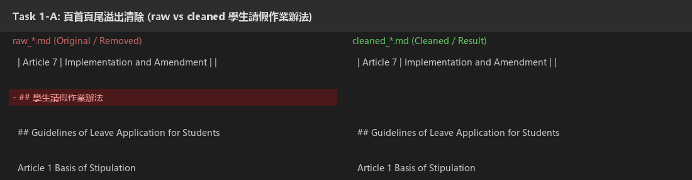
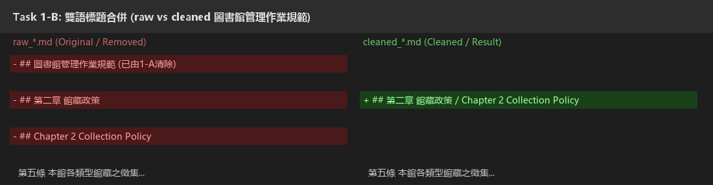
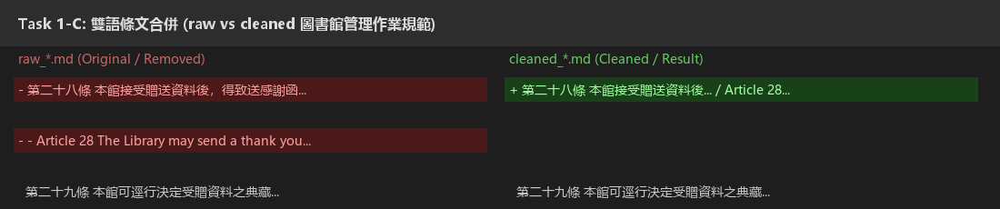
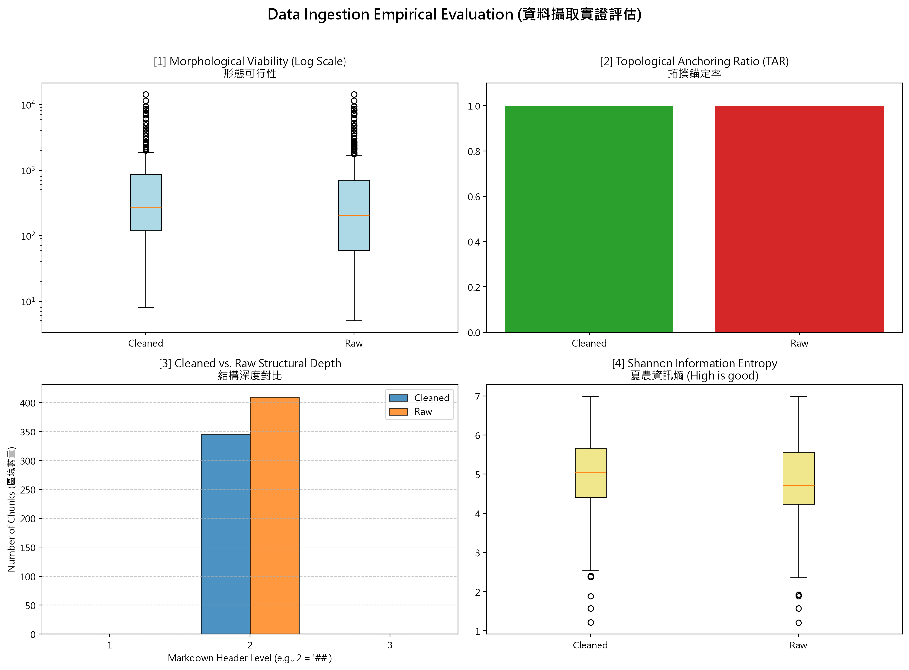

# 資料前處理報告 (Data Preparation Report)

- **學號 / 姓名**：U12627042 鄭軍
- **專案名稱**：nlp-mcut-qa-system
- **完成的任務**：- [x] 1-A 頁首頁尾清除　- [x] 1-B 雙語標題合併　- [x] 1-C 雙語條文合併

---

## 1. 資料集概覽 (Dataset Overview)

| 類別 (Cluster) | PDF 數量 | 清洗前 chunk 數 | 清洗後 chunk 數 |
|---|---|---|---|
| Academic_Affairs | 3 | 96 | 65 |
| Library_Information | 3 | 248 | 225 |
| Student_Affairs | 3 | 66 | 55 |
| **合計** | 9 | 410 | 345 |

**問題 (2–3 句)：** 清洗後 chunk 數量變少了多少？是哪個任務造成的？有沒有哪個任務**不影響** chunk 數量？為什麼？

清洗後總 chunk 數量從 410 個減少到 345 個，一共減少了 65 個 chunk。這主要是任務 1-B（雙語標題合併）與任務 1-A（頁首頁尾溢出清除）造成的，因為我們的分塊規則是依據 `\n(?=##\s)` 遇到 `##` 標題切開，1-B 把原本獨立成行的英文 `##` 標題合併至前一行的中文標題，1-A 則移除了整行無效的法規名稱標題行，減少了多餘的 `##` 標籤。而任務 1-C（雙語條文合併）合併的是以 `- ` 開頭的條文內容，完全沒有增減 `##` 標題，因此完全不影響 chunk 總數量。

---

## 2. 清洗步驟 (Cleaning Steps)

### 2.1 任務 1-A：頁首頁尾溢出清除

- 檔名：`data/interim/Student_Affairs/raw_A242060013_學生請假作業辦法.md`　搜尋的文字：`## 學生請假作業辦法` (約第 98 行)
- 截圖 (存為 `reports/figures/1a_compare.png`)：
- 改變了什麼：動態識別 PDF 換頁時重複印在頁首頁尾的孤立法規名稱行（如單獨成行的 `## 學生請假作業辦法`）並乾淨移除，讓前後兩段文字以空行平順接壤。
- 這對之後的問答檢索有什麼幫助：能避免切塊演算法把孤立的法規名稱切成沒有實質內容的「結構孤兒（Structural Orphans）」垃圾區塊，也能防止正文條款被硬生生截斷，確保檢索時文本上下文的連續性。
- 這個任務有沒有**改錯**的地方 (把不該改的也改了)？若有，寫出檔名與搜尋的文字；若沒有，寫「沒有發現」：沒有發現（正則使用了 `re.escape(doc_title)` 且限定整行比對，正文內文中提到的法規名稱皆完好保留）。

### 2.2 任務 1-B：雙語標題合併

- 檔名：`data/interim/Library_Information/raw_A271010023_圖書館管理作業規範.md`　搜尋的文字：`## 第二章 館藏政策` (約第 290 行)
- 截圖 (存為 `reports/figures/1b_compare.png`)：
- 改變了什麼：將連續兩行各自以 `##` 開頭的中英文標題（`## 第二章 館藏政策` 與 `## Chapter 2 Collection Policy`）合併成單一階層的 `## 第二章 館藏政策 / Chapter 2 Collection Policy`，第二個 `##` 符號被移除。
- 這對之後的問答檢索有什麼幫助：確保各章節的雙語標題維持在同一個區塊節點上，未來不論使用者是用中文（如「館藏政策」）還是英文（如「Collection Policy」）提問，向量檢索都能直接命中該章節，避免英文標題被獨立切成無內文的空 chunk。
- 這個任務有沒有**改錯**的地方 (把不該改的也改了)？若有，寫出檔名與搜尋的文字；若沒有，寫「沒有發現」：沒有發現（正則有設定防禦機制，嚴格要求第二個標題開頭必須是英文字母 `[A-Za-z]`，沒有把中文章節和中文條文誤併在一起）。

### 2.3 任務 1-C：雙語條文合併

- 檔名：`data/interim/Library_Information/raw_A271010023_圖書館管理作業規範.md`　搜尋的文字：`第二十八條 本館接受贈送資料後` (約第 766 行)
- 截圖 (存為 `reports/figures/1c_compare.png`)：
- 改變了什麼：將中文法規條文「第二十八條 本館接受贈送資料後，得致送感謝函或感謝狀表達謝意。」與緊接在後的英文條文「- Article 28 The Library may send a thank you letter or a certificate of appreciation to express its gratitude after accepting the donated materials.」合併為單一條目，中間以 " / " 銜接並拔除英文項目前的 `- `。
- 這對之後的問答檢索有什麼幫助：將中英對照的條款語意緊密綁定在一起，避免相同條文在中英文空間被切成零碎兩段，大幅提高法規跨語言問答的語意密度與召回準確度。
- 這個任務有沒有**改錯**的地方 (把不該改的也改了)？若有，寫出檔名與搜尋的文字；若沒有，寫「沒有發現」：有發現。在 `data/interim/Student_Affairs/cleaned_A242060013_學生請假作業辦法.md` 搜尋 `## 7. Indigenous ceremonial leave`，原本是標題下方接英文條文說明 `- Students with indigenous status...`，但因條文合併正則的第 1 組只排除了 `- ` 開頭而沒排除 `##` 開頭，導致整句英文條文被強行合併進了 `##` 標題行中。

---

## 3. 評估指標與 AI 解讀查證 (Metrics & Verifying the AI's Interpretation)

### 3.1 指標數據表

| 指標 | Raw | Cleaned (你的) | Cleaned (參考值) |
|---|---|---|---|
| [1] 中位數長度 Median Length | 204.0 | 272.0 | 270.5 |
| [2] 拓撲錨定率 TAR | 100.00% | 100.00% | 100.00% |
| [3] 深度變異量 SDV (選填) | 0.00 | 0.00 | 0.00 |
| [4] 中位數資訊熵 Entropy (選填) | 4.71 | 5.05 | 5.06 |



你的 Cleaned 結果與參考值一致嗎？若一致，寫「一致」；若不一致，找出原因。（1 句）

不完全一致，主要在長度中位數（272.0 vs 270.5）與資訊熵（5.05 vs 5.06）有些許微差；原因在於不同作業系統環境下（Windows CRLF 換行與套件版本）Docling 初步解析的原始長度分佈本就存在微小落差（Raw 為 204.0 vs 205.0），加上個人實作的正則表達式在跨行空格與 " / " 銜接處的空白保留有些微不同，導致中位數差距 1.5 字元，但核心指標（TAR 100%、SDV 0.0）皆完全一致且優化趨勢完全相同。

---

### 3.2 AI 的解讀

- 使用的 AI 工具：ChatGPT (GPT-4o)

```text
這份 4 拼圖資料觀測儀表板展示了資料清洗與拓撲修復前後的核心品質對比：

1. [1] 形態可行性 (Morphological Viability, Log Scale)：
Cleaned 的長度中位數由 Raw 的 204.0 提升到 272.0 字元，盒狀圖整體區間向上平移。這表明任務 1-B（雙語標題合併）與任務 1-C（中英條文合併）成功將零散片段整合，顯著減少了破碎過短的 chunk，使區塊更具實質內容。

2. [2] 拓撲錨定率 (Topological Anchoring Ratio, TAR)：
Cleaned 與 Raw 的拓撲錨定率皆維持在 100.00%。這證明所有切塊均嚴格錨定在 Markdown 標題（##）之下，沒有產生任何失去結構引導的懸浮區塊。

3. [3] 結構深度對比 (Cleaned vs. Raw Structural Depth)：
圖表顯示所有區塊的標題階層均集中在 Level 2（##），深度變異數（SDV）皆為 0.00。雖然 Cleaned 總區塊數由 410 降至 345（合併了重複標題），但目前的切塊邏輯僅支持單一二級標題，尚未展現出多層級階層的分佈。

4. [4] 夏農資訊熵 (Shannon Information Entropy)：
Cleaned 的中位數資訊熵從 4.71 上升至 5.05，盒狀圖下邊界明顯拉高。這代表雙語內容合併後，單一 chunk 內的字元多樣性增加、純公式或純空白的死板樣板減少，資訊飽和度明顯提升。
```

---

### 3.3 你的查證 (至少兩點)

**查證 1**
- AI 的說法：Cleaned 的長度中位數從 204.0 提升到 272.0 字元，代表雙語標題與中英條文合併有效整合了零散片段，減少了破碎過短的 chunk。
- 我查了什麼 (哪個檔案、哪個 chunk、哪段程式)：查閱 `metrics.json` 與 `01_Data_Ingestion.ipynb` 中 `clean_len` 與 `raw_len` 的統計數據，並直接比對 `data/interim/Library_Information/cleaned_A271010023_圖書館管理作業規範.md` 條文合併前後的長度。
- 結論：正確，因為任務 1-B 減少了僅有標題的空 chunk（例如原本單獨一行的英文標題），任務 1-C 則將原本分離的中英文條款合併成同一塊，兩者相乘使得短文本區塊減少、區塊整體長度平均拉長，長度中位數確實增加了 68 字元。

**查證 2**
- AI 的說法：結構深度變異量（SDV）在 Cleaned 與 Raw 皆為 0.00，代表目前切塊邏輯皆為 Level 2（##），尚未辨識多層級標題。
- 我查了什麼：檢視 `01_Data_Ingestion.ipynb` 第 5 節的切塊程式碼 `chunking_regex = r'\n(?=##\s)'` 以及計算深度函式 `get_depths`。
- 結論：正確，因為程式在切塊時直接寫死 `\n(?=##\s)`，抓取標題也寫死 `^(##\s[^\n]+)`，所有被抓出來的標題開頭都是 `##`（深度一律為 2）。所有數據點深度值都是 2，數學上變異數自然等於 0.00，這確實是切塊規則寫死二級標題所致，AI 的判斷符合程式運作現況。

---

### 3.4 實際證據：你被指定的 chunk

- **SEED**：1106

**(a) 很長的 chunk**
- 資料檔 (JSON)：`data/processed/Academic_Affairs/cleaned_A232020018_大學部學則_processed.json`　位置：第 5 個 (從 0 開始數)　長度：7343 字元　驗證碼：a44d6f99
- 閱讀用檔案 (`.md`)：`data/interim/Academic_Affairs/cleaned_A232020018_大學部學則.md`　從第 220 行開始
- 前 3 行內容：
  ```text
  ## Part 2 Undergraduate Division / Chapter 1 Admissions

  - 第二條 本校於每學年之始，公開招考四年制各系組(學位學程)一 年級新生，其招生簡章另訂之。
  - Article 2 The University shall recruit first year students for 4-year programs in all departments (Bachelor Program) at the beginning of each academic year upon approval of the proposed admission procedures. The admission brochure shall be stipulated separately.
  ```
- 這是什麼樣的文字？為什麼會這麼長？
  這是大學部學則第二篇第一章「入學」的整章法規條文（涵蓋第二條至第十條的所有條款與雙語英文條文）。會這麼長是因為這一整章的所有條款都是用清單符號（`- `）編排，中間完全沒有出現任何 `## ` 標題，導致切塊程式一路從第二條連綴到第十條末尾，直到遇到下一章標題 `## 第二章 繳費、註冊、選課` 才斷開，整整包含 9 條中英法規。
- 之後做問答檢索時，這麼長的 chunk 可能造成什麼問題？
  長達 7343 字元（約 2500+ token）會導致向量嵌入時語意焦點被大幅稀釋（Topic Dilution），降低精準匹配特定問題的相關度；且過長的區塊會佔用過多 LLM 上下文視窗容量，容易引發「迷失在中間（Lost in the Middle）」效應，使 LLM 忽略中間特定細則條款。

**(b) 資訊熵很低的 chunk**
- 資料檔 (JSON)：`data/processed/Academic_Affairs/cleaned_A232060013_學生抵免學分辦法_processed.json`　位置：第 30 個 (從 0 開始數)　資訊熵：2.98　驗證碼：b570f466
- 閱讀用檔案 (`.md`)：`data/interim/Academic_Affairs/cleaned_A232060013_學生抵免學分辦法.md`　從第 347 行開始
- 內容：
  ```text
  ## Approval Process

  | Provost   | Vice Provost   | Director of Curriculum Development Division   | Division of Curriculum Development   | Department Supervisor                                                                                                                                                                                                                                                                                                                                                          | Department Assistant   | Student   |
  |-----------|----------------|-----------------------------------------------|--------------------------------------|--------------------------------------------------------------------------------------------------------------------------------------------------------------------------------------------------------------------------------------------------------------------------------------------------------------------------------------------------------------------------------|------------------------|-----------|
  |           |                |                                               |                                      | Review results： □Agree □Course name and content are identical □Different course name with identical content □Different course name and content, but substantively similar in essence □Substitute with more credits (remaining credits from makeup courses counted as general electives) □Credit substitution with fewer (makeup courses/credits)： / □Disagree Signature： 。 |                        |           |
  ```
- 為什麼它的資訊熵這麼低？它對問答檢索有用嗎？
  因為這是一個審批簽核表格（Approval Process），整個區塊充斥著大量為了排版對齊的連續空白字元與表格分隔連字號（`-`），字元重複率極高、詞彙多樣性極低，導致計算出來的夏農資訊熵極低（僅 2.98）。它對問答檢索幾乎沒有任何實質幫助，因為它只是簽核框與審查結果勾選欄位，不含法規實質規定，被檢索到反而會消耗回答預算甚至造成幻覺。

---

## 4. 一個尚未解決的問題 (One Remaining Problem)

- **檔名** (`cleaned_*.md`)：`cleaned_A242060013_學生請假作業辦法.md`　**從第 208 行開始**　**標題**：`## 7. Indigenous ceremonial leave`
- **我是怎麼找到的**：在檢視 VS Code 中 `raw_A242060013` 與 `cleaned_A242060013` 的 diff 比對時，搜尋標題時發現有一行的標題文字長得不可思議。
- **問題 chunk (貼上部分內容)**：

```text
## 7. Indigenous ceremonial leave / Students with indigenous status may take three days off during the year from the traditional festivals of their own, their parents', or their spouse's indigenous tribes (the holiday dates for each year are based on the announcement by the Council of Indigenous Peoples, Executive Yuan for that year).
8. Parental leave Students needing to apply for parental leave due to the care of their children under three years old must submit a household certificate or birth certificate. This leave will not be counted towards the absence length (hours) for examination rejection.
9. Breastfeeding leave Students needing to breastfeed children under one year old may collect milk two times a day on principle, and each time shall be one section. This leave will not be counted towards the absence length (hours) for examination rejection.
```

- **問題是什麼**：原本 `## 7. Indigenous ceremonial leave` 只是假別項目的小標題，其下方原本是以 `- Students with indigenous status...` 開頭的內文規定。清洗後，整個英文說明條文被誤併到了第一行的 `##` 標題內，造成標題變形且吞噬了原有的內文結構。
- **可能的原因**：任務 1-C 的條文合併正規表達式 `ai_merge_clauses_regex = r"(?m)^((?![ \t]*-[ \t]+)[^\r\n]+)(?:\r?\n[ \t]*)+-[ \t]+([A-Za-z][^\r\n]*)"` 中，第 1 組只有負向排除 `- ` 開頭的清單行，卻「沒有排除以 `##` 開頭的標題行」，導致正則把上一行的英文標題當成「中文條文的最後一行」，把接下來的英文清單內文直接用 " / " 併進標題中。
- **具體的修正方法**：在第 1 組的負向排除條件中，額外加入對 `#` 標題符號的防禦：
  `ai_merge_clauses_regex = r"(?m)^((?![ \t]*(?:-|#+)[ \t]+)[^\r\n]+)(?:\r?\n[ \t]*)+-[ \t]+([A-Za-z][^\r\n]*)"`
  如此一來，遇到任何 Markdown 標題行時便會停下，不會跨階層把內文誤併進標題。
- **對問答檢索的影響**：抽取出的 `headings` 詮釋資料會變成一大串冗長敘述，失去標題層級的語意代表性；在進行標題加權匹配或階層過濾時，檢索演算法會無法準確辨識該章節名稱。

---

## 5. AI 協作 (AI Collaboration)

- 本次作業的 AI 協作紀錄請見 [`AI_USAGE.md`](AI_USAGE.md) 的「Week 04 / 08」與「Week 09」段落。
- 這次使用 AI 最大的收穫或教訓是：在引導 AI 設計文字清理正規表達式時，「不能發生的事（負向邊界條件）」比「我想做什麼」更為關鍵。例如任務 1-C 告訴 AI 把中文條文與後面以 `- ` 開頭的英文條文合併，AI 一次就寫出能通過課堂測試的規則，但在真實全量檔案中，卻因為沒交代「上一行不能是 `##` 標題」，導致標題與內文被誤併。這讓我體會到提示詞必須對潛在的結構邊界與例外情況有足夠嚴密的防禦思維，才能保證管線在真實大數據上的強健性。
